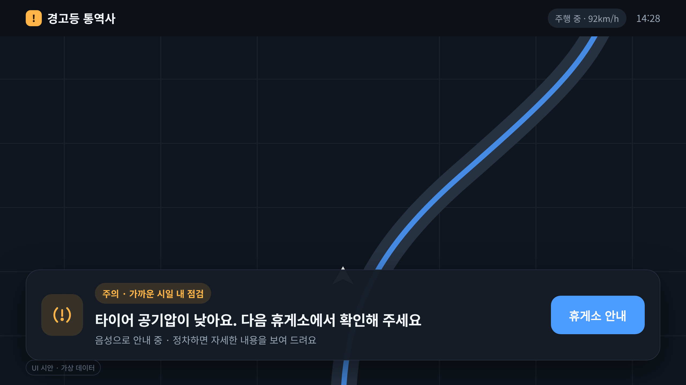
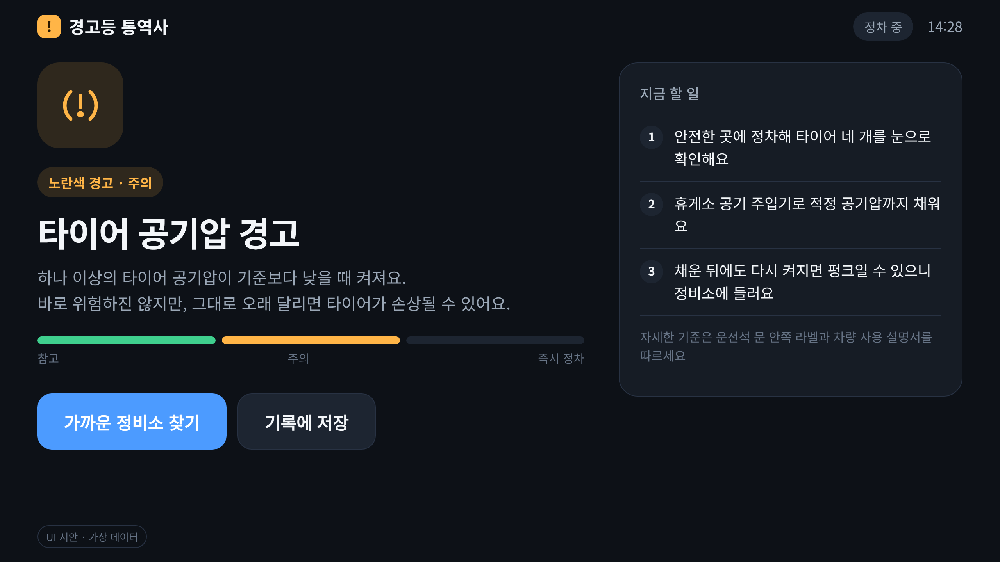
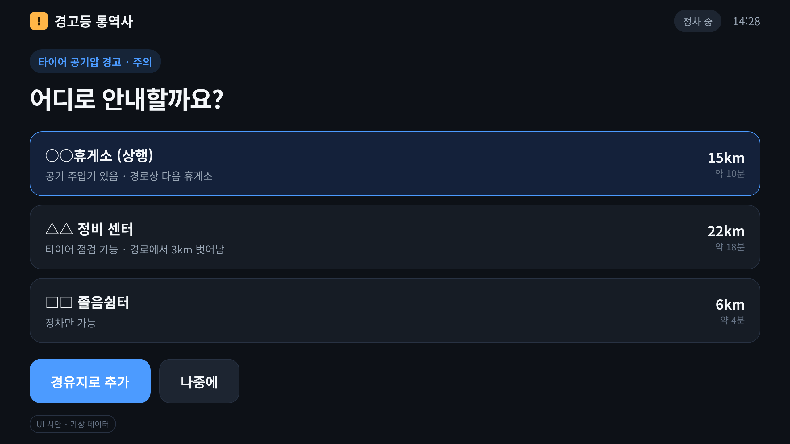
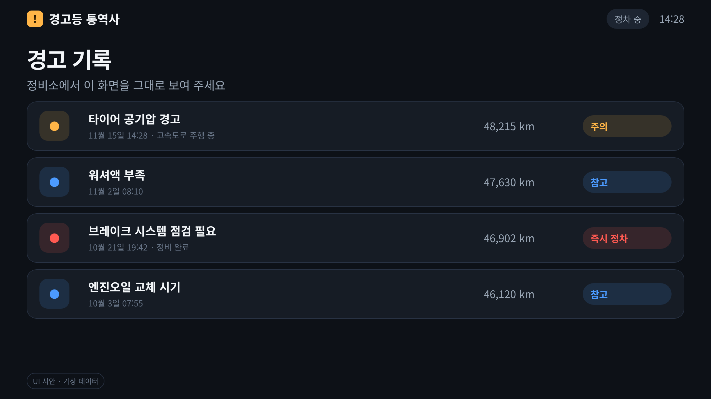

# 경고등 통역사

계기판에 경고등이 켜지면 그 뜻과 위험도를 쉬운 말과 음성으로 알려 주고, 지금 무엇을 해야 하는지와 가까운 정비소까지 안내하는 Pleos Connect 차량 앱입니다.

> **현재 단계: 기획 + UI 시안 (가상 데이터)**
> 이 저장소에는 화면 시안만 들어 있습니다. 경고 정보, 위치, 거리, 기록은 모두 가상 데이터이며 Vehicle SDK 연동은 아직 구현하지 않았습니다.

## 화면

| 1. 주행 중 경고 안내 | 2. 경고 상세 (정차 후) |
| --- | --- |
|  |  |
| **3. 정비소·휴게소 안내** | **4. 경고 기록** |
|  |  |

## 실행 방법

설치할 것이 없습니다. `index.html`을 브라우저로 열고, 주소 뒤에 `?s=1` ~ `?s=4`를 붙이면 각 화면이 열립니다.

## 테스트 환경

- 화면 규격: 1280×720 가로 화면 기준
- 확인 환경: Chrome 브라우저
- Pleos Connect Emulator: 아직 검증하지 않음
- APK: 이번 제출에 포함하지 않음

## 사용 예정 SDK

| 도메인 / SDK | 용도 | 퍼미션 |
| --- | --- | --- |
| Safety (TelltaleData, Telltales) | 경고등 종류·색·상태 조회와 구독 | CAR_SAFETY |
| Tire | 타이어 상태 조회 | CAR_SAFETY |
| Odometer | 경고 발생 시점 주행 거리 기록 | CAR_DRIVE |
| EvBattery | 전기차 배터리·충전 상태 기록 | CAR_ENERGY |
| NaviHelper SDK | 휴게소·정비소 경유지 추가 | 확인 예정 |
| TextToSpeech SDK | 음성 안내 | 확인 예정 |
| Gleo Interface | 방금 뜬 경고 설명, 켜진 경고 목록, 정비소 찾기 | - |

차량을 제어하지 않고 상태를 읽기만 하므로 제어 퍼미션이 필요하지 않습니다. 함수 서명과 퍼미션은 API Reference와 에뮬레이터에서 확인한 뒤 확정합니다.

## 구현 계획

1. 에뮬레이터 Virtual Console로 경고 상태를 바꿔 감지 흐름 검증
2. 주요 경고 설명 데이터(쉬운 설명, 위험도, 할 일) 구축과 경고 기록 저장
3. 음성 안내, 정비소 안내, Gleo 연동

---

warning-light-team
